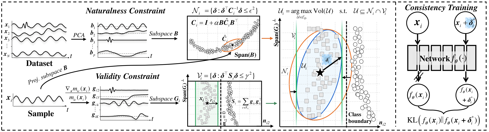

# NaVa: Natural and Valid Perturbation

   [](https://huggingface.co/isyuisuen/NaVa-UCR-10pct)

Code for *NaVa: Constructing Natural and Valid Perturbation Feasible Sets for Semi-Supervised Time Series Classification*.

Rui Sun<sup>1</sup>, Yujia Chen<sup>2</sup>, Huayu Mai<sup>2</sup>, Yu Liu<sup>3,†</sup>, Tianzhu Zhang<sup>2</sup>, Yongdong Zhang<sup>2</sup>, Feng Wu<sup>2</sup>, You He<sup>3</sup>

<sup>1</sup> Shenzhen International Graduate School, Tsinghua University<br>
<sup>2</sup> School of Information Science and Technology, University of Science and Technology of China<br>
<sup>3</sup> Department of Electronic Engineering, Tsinghua University<br>
<sup>†</sup> Corresponding author

## ✨ Overview



For every series, NaVa builds the perturbation feasible set as the maximum-volume ellipsoid inside two constraints:

* 🌿 **Naturalness**: extends along the local variations of real series, estimated from neighbours in a PCA subspace of all training series (`nava/naturalness.py`).
* 🛡️ **Validity**: stops before the class boundary of the current model (`nava/perturbation.py`).

The ellipsoid has a closed form; the perturbation inside it is found by one power iteration, and consistency is enforced with the KL divergence (`nava/trainer.py`).

## 📊 Main results

Average test accuracy (%) over the 106 UCR datasets as reported in the paper (each dataset: mean over the 5 folds).

| Method | 10% labels | 20% labels | 40% labels |
|---|---|---|---|
| CompleMatch (strongest baseline) | 78.67 | 81.98 | 84.87 |
| **NaVa** | **82.93** | **86.03** | **88.48** |

## ⚙️ Installation

```bash
pip install -r requirements.txt
```

## 📦 Data

| Benchmark | Datasets | Labeled ratios | Source |
|---|---|---|---|
| UCR | 106 (`datasets/ucr106.txt`) | 10%, 20%, 40% | [UCR archive 2018](https://www.cs.ucr.edu/~eamonn/time_series_data_2018/) |
| UEA | 5 (`datasets/uea5.txt`) | 10% | [UEA archive](https://www.timeseriesclassification.com/) |
| Real-world | 10 (`datasets/realworld10.txt`) | 1%, 5% | 7 from the UCR archive; HAR, Epilepsy and sleepEDF as released with [CA-TCC](https://github.com/emadeldeen24/CA-TCC) |

Download the archives, then build the splits:

```bash
python scripts/make_splits.py --benchmark ucr       --root /path/to/UCRArchive_2018 --out data/ucr
python scripts/make_splits.py --benchmark uea       --root /path/to/Multivariate_ts --out data/uea
python scripts/make_splits.py --benchmark realworld --root /path/to/UCRArchive_2018 \
       --catcc_root /path/to/CA-TCC/data --out data/realworld
```

The UCR and UEA datasets, and the 7 real-world datasets from the UCR archive, are split by stratified 5-fold cross-validation with seed 2001 (60% training, 20% validation, 20% test). HAR, Epilepsy and sleepEDF keep the training, validation and test sets released by CA-TCC, with the labeled series drawn 5 times.

## 🚀 Training

```bash
python scripts/run.py --config configs/ucr.yaml --dataset GunPoint --ratio 0.1 --fold 0 --out results/gunpoint_f0.json
```

The hyperparameters of the dataset are read from `nava/hparams/` (any of them can be overridden on the command line, e.g. `--eps 2`). The reported test accuracy is the one at the evaluation with the highest validation accuracy. GPU training is not bit-wise deterministic, so repeated runs vary slightly.

<!-- weights:start -->
## 🤗 Pretrained weights (UCR, 10% labeled series)

The FCN classifiers of all 106 UCR datasets and 5 folds are on the Hugging Face Hub ([isyuisuen/NaVa-UCR-10pct](https://huggingface.co/isyuisuen/NaVa-UCR-10pct)). After building the splits:

```bash
python scripts/evaluate.py --dataset GunPoint     # downloads the 5 folds and reports their test accuracy
```

<details>
<summary>Test accuracy of the released weights (mean ± std over the 5 folds)</summary>

| Dataset | Test accuracy (%) | Weights |
|---|---|---|
| AllGestureWiimoteX | 59.50 ± 4.49 | [link](https://huggingface.co/isyuisuen/NaVa-UCR-10pct/tree/main/AllGestureWiimoteX) |
| AllGestureWiimoteY | 66.70 ± 3.21 | [link](https://huggingface.co/isyuisuen/NaVa-UCR-10pct/tree/main/AllGestureWiimoteY) |
| AllGestureWiimoteZ | 54.00 ± 2.42 | [link](https://huggingface.co/isyuisuen/NaVa-UCR-10pct/tree/main/AllGestureWiimoteZ) |
| ArrowHead | 86.28 ± 5.33 | [link](https://huggingface.co/isyuisuen/NaVa-UCR-10pct/tree/main/ArrowHead) |
| BME | 91.11 ± 8.65 | [link](https://huggingface.co/isyuisuen/NaVa-UCR-10pct/tree/main/BME) |
| CBF | 100.00 ± 0.00 | [link](https://huggingface.co/isyuisuen/NaVa-UCR-10pct/tree/main/CBF) |
| Car | 82.50 ± 6.85 | [link](https://huggingface.co/isyuisuen/NaVa-UCR-10pct/tree/main/Car) |
| Chinatown | 99.45 ± 0.76 | [link](https://huggingface.co/isyuisuen/NaVa-UCR-10pct/tree/main/Chinatown) |
| ChlorineConcentration | 71.91 ± 2.84 | [link](https://huggingface.co/isyuisuen/NaVa-UCR-10pct/tree/main/ChlorineConcentration) |
| CinCECGTorso | 96.48 ± 2.45 | [link](https://huggingface.co/isyuisuen/NaVa-UCR-10pct/tree/main/CinCECGTorso) |
| Computers | 80.80 ± 4.66 | [link](https://huggingface.co/isyuisuen/NaVa-UCR-10pct/tree/main/Computers) |
| CricketX | 64.74 ± 4.73 | [link](https://huggingface.co/isyuisuen/NaVa-UCR-10pct/tree/main/CricketX) |
| CricketY | 58.85 ± 4.11 | [link](https://huggingface.co/isyuisuen/NaVa-UCR-10pct/tree/main/CricketY) |
| CricketZ | 62.31 ± 4.52 | [link](https://huggingface.co/isyuisuen/NaVa-UCR-10pct/tree/main/CricketZ) |
| Crop | 68.30 ± 0.47 | [link](https://huggingface.co/isyuisuen/NaVa-UCR-10pct/tree/main/Crop) |
| DiatomSizeReduction | 100.00 ± 0.00 | [link](https://huggingface.co/isyuisuen/NaVa-UCR-10pct/tree/main/DiatomSizeReduction) |
| DistalPhalanxOutlineAgeGroup | 86.46 ± 2.42 | [link](https://huggingface.co/isyuisuen/NaVa-UCR-10pct/tree/main/DistalPhalanxOutlineAgeGroup) |
| DistalPhalanxOutlineCorrect | 84.59 ± 3.17 | [link](https://huggingface.co/isyuisuen/NaVa-UCR-10pct/tree/main/DistalPhalanxOutlineCorrect) |
| DistalPhalanxTW | 78.67 ± 2.50 | [link](https://huggingface.co/isyuisuen/NaVa-UCR-10pct/tree/main/DistalPhalanxTW) |
| DodgerLoopGame | 93.71 ± 5.85 | [link](https://huggingface.co/isyuisuen/NaVa-UCR-10pct/tree/main/DodgerLoopGame) |
| DodgerLoopWeekend | 97.48 ± 1.41 | [link](https://huggingface.co/isyuisuen/NaVa-UCR-10pct/tree/main/DodgerLoopWeekend) |
| ECG200 | 91.00 ± 2.24 | [link](https://huggingface.co/isyuisuen/NaVa-UCR-10pct/tree/main/ECG200) |
| ECG5000 | 95.06 ± 0.27 | [link](https://huggingface.co/isyuisuen/NaVa-UCR-10pct/tree/main/ECG5000) |
| ECGFiveDays | 100.00 ± 0.00 | [link](https://huggingface.co/isyuisuen/NaVa-UCR-10pct/tree/main/ECGFiveDays) |
| EOGHorizontalSignal | 53.46 ± 7.48 | [link](https://huggingface.co/isyuisuen/NaVa-UCR-10pct/tree/main/EOGHorizontalSignal) |
| EOGVerticalSignal | 49.03 ± 1.96 | [link](https://huggingface.co/isyuisuen/NaVa-UCR-10pct/tree/main/EOGVerticalSignal) |
| Earthquakes | 81.13 ± 1.16 | [link](https://huggingface.co/isyuisuen/NaVa-UCR-10pct/tree/main/Earthquakes) |
| ElectricDevices | 84.72 ± 0.44 | [link](https://huggingface.co/isyuisuen/NaVa-UCR-10pct/tree/main/ElectricDevices) |
| EthanolLevel | 56.17 ± 2.77 | [link](https://huggingface.co/isyuisuen/NaVa-UCR-10pct/tree/main/EthanolLevel) |
| FaceAll | 97.47 ± 1.82 | [link](https://huggingface.co/isyuisuen/NaVa-UCR-10pct/tree/main/FaceAll) |
| FacesUCR | 97.42 ± 0.54 | [link](https://huggingface.co/isyuisuen/NaVa-UCR-10pct/tree/main/FacesUCR) |
| Fish | 86.29 ± 2.39 | [link](https://huggingface.co/isyuisuen/NaVa-UCR-10pct/tree/main/Fish) |
| FordA | 91.81 ± 1.19 | [link](https://huggingface.co/isyuisuen/NaVa-UCR-10pct/tree/main/FordA) |
| FordB | 89.61 ± 0.98 | [link](https://huggingface.co/isyuisuen/NaVa-UCR-10pct/tree/main/FordB) |
| FreezerRegularTrain | 99.97 ± 0.07 | [link](https://huggingface.co/isyuisuen/NaVa-UCR-10pct/tree/main/FreezerRegularTrain) |
| FreezerSmallTrain | 100.00 ± 0.00 | [link](https://huggingface.co/isyuisuen/NaVa-UCR-10pct/tree/main/FreezerSmallTrain) |
| GesturePebbleZ1 | 87.52 ± 4.69 | [link](https://huggingface.co/isyuisuen/NaVa-UCR-10pct/tree/main/GesturePebbleZ1) |
| GesturePebbleZ2 | 80.28 ± 5.50 | [link](https://huggingface.co/isyuisuen/NaVa-UCR-10pct/tree/main/GesturePebbleZ2) |
| GunPoint | 100.00 ± 0.00 | [link](https://huggingface.co/isyuisuen/NaVa-UCR-10pct/tree/main/GunPoint) |
| GunPointAgeSpan | 99.56 ± 0.99 | [link](https://huggingface.co/isyuisuen/NaVa-UCR-10pct/tree/main/GunPointAgeSpan) |
| GunPointMaleVersusFemale | 100.00 ± 0.00 | [link](https://huggingface.co/isyuisuen/NaVa-UCR-10pct/tree/main/GunPointMaleVersusFemale) |
| GunPointOldVersusYoung | 98.89 ± 1.92 | [link](https://huggingface.co/isyuisuen/NaVa-UCR-10pct/tree/main/GunPointOldVersusYoung) |
| Ham | 74.75 ± 9.12 | [link](https://huggingface.co/isyuisuen/NaVa-UCR-10pct/tree/main/Ham) |
| HandOutlines | 88.03 ± 2.53 | [link](https://huggingface.co/isyuisuen/NaVa-UCR-10pct/tree/main/HandOutlines) |
| Haptics | 44.93 ± 2.17 | [link](https://huggingface.co/isyuisuen/NaVa-UCR-10pct/tree/main/Haptics) |
| Herring | 69.54 ± 9.54 | [link](https://huggingface.co/isyuisuen/NaVa-UCR-10pct/tree/main/Herring) |
| HouseTwenty | 99.38 ± 1.40 | [link](https://huggingface.co/isyuisuen/NaVa-UCR-10pct/tree/main/HouseTwenty) |
| InlineSkate | 46.46 ± 3.11 | [link](https://huggingface.co/isyuisuen/NaVa-UCR-10pct/tree/main/InlineSkate) |
| InsectEPGRegularTrain | 100.00 ± 0.00 | [link](https://huggingface.co/isyuisuen/NaVa-UCR-10pct/tree/main/InsectEPGRegularTrain) |
| InsectEPGSmallTrain | 98.87 ± 1.03 | [link](https://huggingface.co/isyuisuen/NaVa-UCR-10pct/tree/main/InsectEPGSmallTrain) |
| InsectWingbeatSound | 43.32 ± 2.05 | [link](https://huggingface.co/isyuisuen/NaVa-UCR-10pct/tree/main/InsectWingbeatSound) |
| ItalyPowerDemand | 97.81 ± 0.75 | [link](https://huggingface.co/isyuisuen/NaVa-UCR-10pct/tree/main/ItalyPowerDemand) |
| LargeKitchenAppliances | 89.33 ± 4.29 | [link](https://huggingface.co/isyuisuen/NaVa-UCR-10pct/tree/main/LargeKitchenAppliances) |
| Lightning2 | 74.33 ± 9.16 | [link](https://huggingface.co/isyuisuen/NaVa-UCR-10pct/tree/main/Lightning2) |
| Mallat | 99.33 ± 0.50 | [link](https://huggingface.co/isyuisuen/NaVa-UCR-10pct/tree/main/Mallat) |
| Meat | 100.00 ± 0.00 | [link](https://huggingface.co/isyuisuen/NaVa-UCR-10pct/tree/main/Meat) |
| MedicalImages | 71.60 ± 1.23 | [link](https://huggingface.co/isyuisuen/NaVa-UCR-10pct/tree/main/MedicalImages) |
| MelbournePedestrian | 86.37 ± 0.75 | [link](https://huggingface.co/isyuisuen/NaVa-UCR-10pct/tree/main/MelbournePedestrian) |
| MiddlePhalanxOutlineAgeGroup | 78.88 ± 1.16 | [link](https://huggingface.co/isyuisuen/NaVa-UCR-10pct/tree/main/MiddlePhalanxOutlineAgeGroup) |
| MiddlePhalanxOutlineCorrect | 85.30 ± 3.66 | [link](https://huggingface.co/isyuisuen/NaVa-UCR-10pct/tree/main/MiddlePhalanxOutlineCorrect) |
| MiddlePhalanxTW | 64.74 ± 2.72 | [link](https://huggingface.co/isyuisuen/NaVa-UCR-10pct/tree/main/MiddlePhalanxTW) |
| MixedShapesRegularTrain | 94.97 ± 1.44 | [link](https://huggingface.co/isyuisuen/NaVa-UCR-10pct/tree/main/MixedShapesRegularTrain) |
| MixedShapesSmallTrain | 94.26 ± 1.23 | [link](https://huggingface.co/isyuisuen/NaVa-UCR-10pct/tree/main/MixedShapesSmallTrain) |
| MoteStrain | 97.64 ± 1.11 | [link](https://huggingface.co/isyuisuen/NaVa-UCR-10pct/tree/main/MoteStrain) |
| NonInvasiveFetalECGThorax1 | 88.31 ± 1.59 | [link](https://huggingface.co/isyuisuen/NaVa-UCR-10pct/tree/main/NonInvasiveFetalECGThorax1) |
| NonInvasiveFetalECGThorax2 | 89.64 ± 0.51 | [link](https://huggingface.co/isyuisuen/NaVa-UCR-10pct/tree/main/NonInvasiveFetalECGThorax2) |
| OSULeaf | 88.23 ± 7.64 | [link](https://huggingface.co/isyuisuen/NaVa-UCR-10pct/tree/main/OSULeaf) |
| PLAID | 68.81 ± 4.61 | [link](https://huggingface.co/isyuisuen/NaVa-UCR-10pct/tree/main/PLAID) |
| PhalangesOutlinesCorrect | 81.30 ± 1.19 | [link](https://huggingface.co/isyuisuen/NaVa-UCR-10pct/tree/main/PhalangesOutlinesCorrect) |
| Phoneme | 33.79 ± 2.57 | [link](https://huggingface.co/isyuisuen/NaVa-UCR-10pct/tree/main/Phoneme) |
| Plane | 100.00 ± 0.00 | [link](https://huggingface.co/isyuisuen/NaVa-UCR-10pct/tree/main/Plane) |
| PowerCons | 85.83 ± 4.54 | [link](https://huggingface.co/isyuisuen/NaVa-UCR-10pct/tree/main/PowerCons) |
| ProximalPhalanxOutlineAgeGroup | 87.44 ± 3.81 | [link](https://huggingface.co/isyuisuen/NaVa-UCR-10pct/tree/main/ProximalPhalanxOutlineAgeGroup) |
| ProximalPhalanxOutlineCorrect | 88.22 ± 3.77 | [link](https://huggingface.co/isyuisuen/NaVa-UCR-10pct/tree/main/ProximalPhalanxOutlineCorrect) |
| ProximalPhalanxTW | 84.63 ± 1.71 | [link](https://huggingface.co/isyuisuen/NaVa-UCR-10pct/tree/main/ProximalPhalanxTW) |
| RefrigerationDevices | 59.87 ± 3.03 | [link](https://huggingface.co/isyuisuen/NaVa-UCR-10pct/tree/main/RefrigerationDevices) |
| ScreenType | 61.73 ± 4.04 | [link](https://huggingface.co/isyuisuen/NaVa-UCR-10pct/tree/main/ScreenType) |
| SemgHandGenderCh2 | 81.56 ± 4.22 | [link](https://huggingface.co/isyuisuen/NaVa-UCR-10pct/tree/main/SemgHandGenderCh2) |
| SemgHandMovementCh2 | 44.89 ± 3.86 | [link](https://huggingface.co/isyuisuen/NaVa-UCR-10pct/tree/main/SemgHandMovementCh2) |
| SemgHandSubjectCh2 | 70.56 ± 1.84 | [link](https://huggingface.co/isyuisuen/NaVa-UCR-10pct/tree/main/SemgHandSubjectCh2) |
| ShapeletSim | 100.00 ± 0.00 | [link](https://huggingface.co/isyuisuen/NaVa-UCR-10pct/tree/main/ShapeletSim) |
| SmallKitchenAppliances | 77.33 ± 3.74 | [link](https://huggingface.co/isyuisuen/NaVa-UCR-10pct/tree/main/SmallKitchenAppliances) |
| SmoothSubspace | 99.67 ± 0.75 | [link](https://huggingface.co/isyuisuen/NaVa-UCR-10pct/tree/main/SmoothSubspace) |
| SonyAIBORobotSurface1 | 100.00 ± 0.00 | [link](https://huggingface.co/isyuisuen/NaVa-UCR-10pct/tree/main/SonyAIBORobotSurface1) |
| SonyAIBORobotSurface2 | 100.00 ± 0.00 | [link](https://huggingface.co/isyuisuen/NaVa-UCR-10pct/tree/main/SonyAIBORobotSurface2) |
| StarLightCurves | 97.72 ± 0.59 | [link](https://huggingface.co/isyuisuen/NaVa-UCR-10pct/tree/main/StarLightCurves) |
| Strawberry | 95.52 ± 1.22 | [link](https://huggingface.co/isyuisuen/NaVa-UCR-10pct/tree/main/Strawberry) |
| SwedishLeaf | 91.29 ± 0.87 | [link](https://huggingface.co/isyuisuen/NaVa-UCR-10pct/tree/main/SwedishLeaf) |
| Symbols | 99.90 ± 0.22 | [link](https://huggingface.co/isyuisuen/NaVa-UCR-10pct/tree/main/Symbols) |
| SyntheticControl | 100.00 ± 0.00 | [link](https://huggingface.co/isyuisuen/NaVa-UCR-10pct/tree/main/SyntheticControl) |
| ToeSegmentation1 | 95.93 ± 5.46 | [link](https://huggingface.co/isyuisuen/NaVa-UCR-10pct/tree/main/ToeSegmentation1) |
| ToeSegmentation2 | 95.78 ± 3.46 | [link](https://huggingface.co/isyuisuen/NaVa-UCR-10pct/tree/main/ToeSegmentation2) |
| Trace | 100.00 ± 0.00 | [link](https://huggingface.co/isyuisuen/NaVa-UCR-10pct/tree/main/Trace) |
| TwoLeadECG | 100.00 ± 0.00 | [link](https://huggingface.co/isyuisuen/NaVa-UCR-10pct/tree/main/TwoLeadECG) |
| TwoPatterns | 92.72 ± 0.95 | [link](https://huggingface.co/isyuisuen/NaVa-UCR-10pct/tree/main/TwoPatterns) |
| UMD | 100.00 ± 0.00 | [link](https://huggingface.co/isyuisuen/NaVa-UCR-10pct/tree/main/UMD) |
| UWaveGestureLibraryAll | 78.79 ± 1.59 | [link](https://huggingface.co/isyuisuen/NaVa-UCR-10pct/tree/main/UWaveGestureLibraryAll) |
| UWaveGestureLibraryX | 75.17 ± 0.63 | [link](https://huggingface.co/isyuisuen/NaVa-UCR-10pct/tree/main/UWaveGestureLibraryX) |
| UWaveGestureLibraryY | 64.34 ± 0.81 | [link](https://huggingface.co/isyuisuen/NaVa-UCR-10pct/tree/main/UWaveGestureLibraryY) |
| UWaveGestureLibraryZ | 70.10 ± 1.10 | [link](https://huggingface.co/isyuisuen/NaVa-UCR-10pct/tree/main/UWaveGestureLibraryZ) |
| Wafer | 100.00 ± 0.00 | [link](https://huggingface.co/isyuisuen/NaVa-UCR-10pct/tree/main/Wafer) |
| Wine | 76.68 ± 6.80 | [link](https://huggingface.co/isyuisuen/NaVa-UCR-10pct/tree/main/Wine) |
| WordSynonyms | 46.74 ± 3.04 | [link](https://huggingface.co/isyuisuen/NaVa-UCR-10pct/tree/main/WordSynonyms) |
| Worms | 63.53 ± 6.73 | [link](https://huggingface.co/isyuisuen/NaVa-UCR-10pct/tree/main/Worms) |
| WormsTwoClass | 73.67 ± 6.92 | [link](https://huggingface.co/isyuisuen/NaVa-UCR-10pct/tree/main/WormsTwoClass) |
| Yoga | 86.88 ± 0.93 | [link](https://huggingface.co/isyuisuen/NaVa-UCR-10pct/tree/main/Yoga) |

</details>
<!-- weights:end -->

## 🙏 Acknowledgements

We thank the maintainers of the [UCR](https://www.cs.ucr.edu/~eamonn/time_series_data_2018/) and [UEA](https://www.timeseriesclassification.com/) time series classification archives, and the authors of [CA-TCC](https://github.com/emadeldeen24/CA-TCC) for releasing the preprocessed HAR, Epilepsy and Sleep-EDF data.

## 📜 License

MIT (see `LICENSE`).
